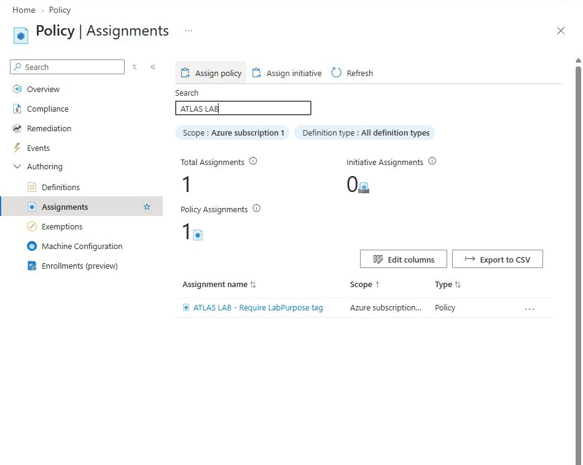
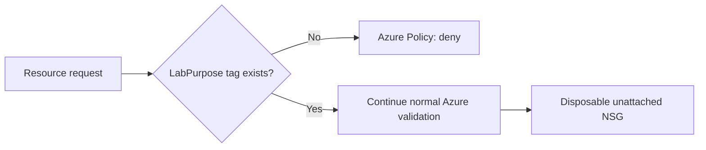

# ATLAS Azure Policy Guardrails Lab

A small Azure governance lab showing that a resource-group-scoped policy can reject an untagged resource, permit a corrected deployment, and reject removal of its required tag.

**Observed in Azure on 12 October 2026.** This is a real portal exercise using one disposable, unattached network security group in North Europe. It does not simulate attacks or generate network traffic.

## Verified outcomes

| Test | Observed result | Evidence |
|---|---|---|
| Assign built-in `Require a tag on resources` to the lab group | Assignment created; `LabPurpose` required, enforcement Default | [Assignment](evidence/01-policy-assigned.png) |
| Validate `nsg-atlas-policy-test` with no tags | Azure ARM validation rejected it with `RequestDisallowedByPolicy` and the lab's message | [Test record](docs/RESULTS.md) |
| Add `LabPurpose=ATLAS-Policy-Guardrails` | Validation passed, deployment completed, resource and tag verified | [Test record](docs/RESULTS.md) |
| Remove `LabPurpose` from the existing NSG through Tags > Apply | Azure rejected the update with `RequestDisallowedByPolicy`; tag remained present on 13 October | [Test record](docs/RESULTS.md) |

The negative creation test was stopped by **server-side pre-deployment validation**; it is not presented as a completed failed resource deployment. The positive case was actually deployed. Test records are in [RESULTS.md](docs/RESULTS.md).

## Design

The policy applies only to `rg-atlas-policy-20261012`. It uses a Microsoft built-in definition in `Indexed` mode. No managed identity, role grant, remediation task, exemption or subscription-wide assignment was created.

This control enforces **tag presence**, not a particular tag value, cost ceiling, network isolation or production compliance baseline. It does not replace RBAC or cost protection.

## Contents

- [Runbook and policy semantics](docs/RUNBOOK.md)
- [Observed results and limitations](docs/RESULTS.md)
- [Costs and trial boundaries](docs/COSTS.md)
- [Cleanup record](CLEANUP.md)
- [Policy assignment reference](infra/policy-assignment.json)
- [NSG test template reference](infra/test-nsg.json)

The ARM files are hand-authored reference material, not exported or deployment-tested infrastructure. The observed lab used the Azure portal. The published assignment screenshot is a real capture cropped to exclude the account header and PNG-optimized; evidence content was not synthesized. Four additional test screenshots are retained locally and are not part of this public release. Private account identifiers and raw portal records are excluded from this repository.

Work spanned sessions on 12–13 October. Active labor time was not measured, and elapsed wall-clock time is not an operational performance metric.

